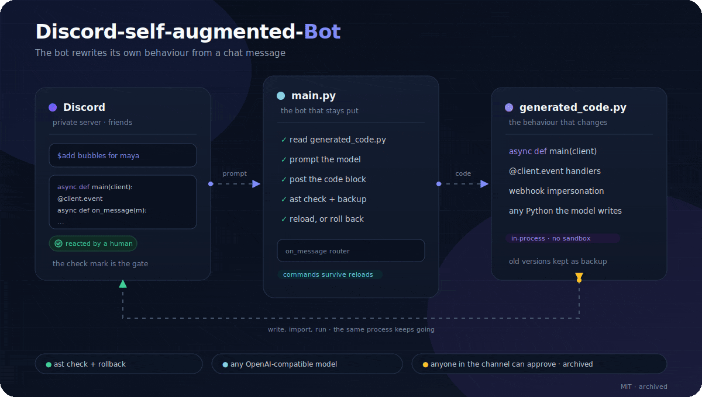
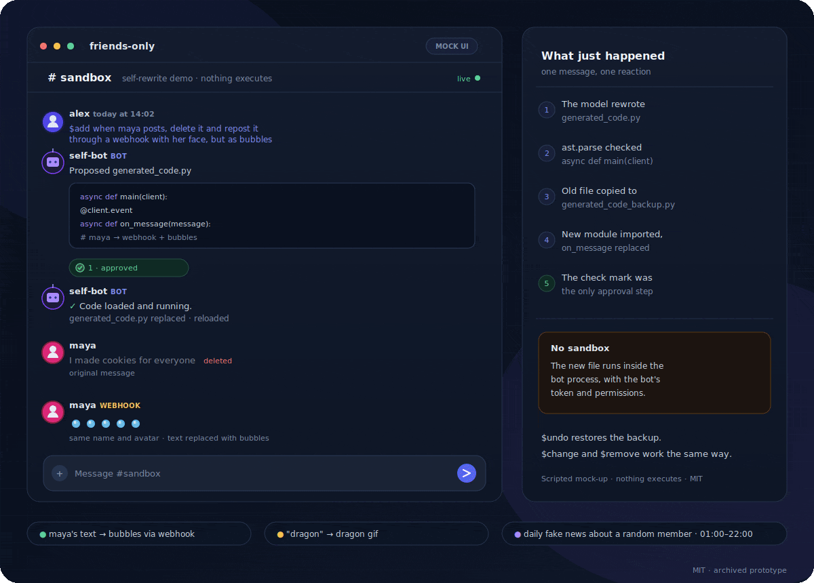

# Discord-self-augmented-Bot

**A Discord bot that could rewrite itself from a chat message.**

The 2024 prototype behind [Pre-Forge](https://github.com/edouwarden/Pre-Forge) and [TheForge](https://github.com/edouwarden/theforge). Archived experiment, not a maintained bot.



## How it worked

`$add`, `$change` and `$remove` send the current `generated_code.py` and the request to an LLM. The reply is posted as a code block. Reacting with ✅ backs up the old file, writes the new one, imports it, and calls `async def main(client)`. `$undo` restores the backup. `main.py` checks the file with `ast` before loading and rolls back if it raises.

| Message | Effect |
| --- | --- |
| `$add <feature>` | Propose the file with the feature added |
| `$change <change>` | Propose the file with the change applied |
| `$remove <feature>` | Propose the file without the feature |
| `$undo` / `$restore` | Reload `generated_code_backup.py` |
| anything else | Chat with the model |



The demo is a scripted mock-up; nothing executes. It shows three example requests: reposting one member's messages through a webhook as bubbles, a dragon GIF when someone mentions `dragon`, and a daily fake-news item about a random member between 01:00 and 22:00. The animated SVGs are in `assets/` too.

## Where it came from

It started in a private server with friends. The first trick deleted a friend's message and reposted it through a webhook with the same name and avatar, but as C:

```c
char *original_message = (char *) malloc(sizeof(char) * 42);
putstr(original_message, "the original message");
free(original_message);
```

That is still in `generated_code_backup.py`. The self-rewrite loop came next; Pre-Forge later pointed it at a sandboxed coding agent.

## Run

Python 3.9+.

```bash
pip install -r requirements.txt
cp .env.example .env
python main.py
```

Set `DISCORD_TOKEN`, `ALLOWED_CHANNEL_IDS` and `LLM_API_KEY`. Enable Message Content Intent; the demo needs Manage Messages and Manage Webhooks.

## Limits

- **No sandbox.** The generated file runs in the bot process with the bot's token. Anyone who can post in the channel and react with ✅ can run Python as the bot.
- ✅ is the only review step; model output is treated as code.
- Webhooks are created per matching message and need Manage Webhooks. Discord rate-limits them.
- The original used g4f's `FakeGpt`, which no longer exists upstream. The model call is now a plain OpenAI-compatible request and needs a key.

Checked with `py_compile` and a stubbed model reply; no live Discord or model call was run.

## License

MIT. Archived; no support.
